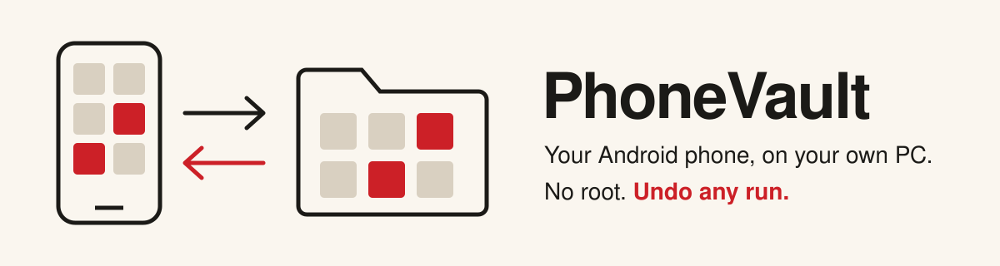
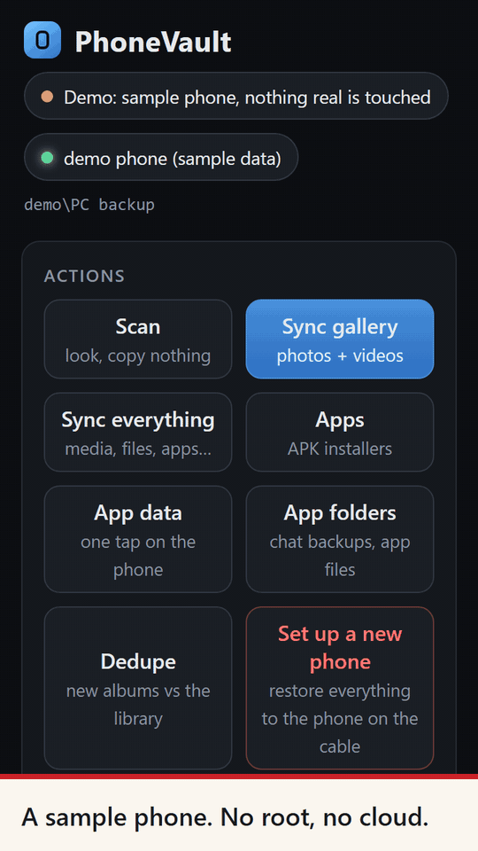

<picture>
  <source media="(prefers-color-scheme: dark)" srcset="assets/banner-dark.svg">
  
</picture>

**Back up your Android phone to your own PC. No root, no cloud, and every backup run can be undone.**

[](https://github.com/zed-dz/phonevault/actions/workflows/ci.yml)
[](LICENSE)



## Who it is for

- You want your photos, apps, contacts and text messages on a disk you own.
- You sort your pictures into folders on the PC and do not want the same ones copied again.
- You do not want to root the phone.

## Try it

You need [Python 3.11 or newer](https://www.python.org/downloads/) and [pipx](https://github.com/pypa/pipx). You do not need a phone for this:

```
pipx install git+https://github.com/zed-dz/phonevault
phonevault demo
```

A dashboard opens with a sample phone. Press **Sync everything**, then press **Undo** on a run. The demo lives in one temp folder and never looks for a real phone.

## Back up your own phone

1. Install adb. Windows: `winget install Google.PlatformTools`. macOS: `brew install android-platform-tools`. Linux: your package manager's `adb`.
2. On the phone, turn on [USB debugging](https://developer.android.com/studio/debug/dev-options#enable), plug the cable in, and tap **Allow**.
3. Run:

```
phonevault config --set pc_root="E:\My phone"     # optional, the default is a PhoneVault folder in your home
phonevault status                                 # does it see the phone?
phonevault scan                                   # what would be copied, per album. Copies nothing
phonevault backup                                 # everything
```

`phonevault serve` opens the dashboard for the real phone. `phonevault undo` reverses the last run.

## What it does

| Part | What you get on the PC |
|---|---|
| Photos and videos | Each phone album goes to the PC folder with the same name, wherever that folder is. New albums wait in `_New from phone` until you file them. |
| Other files | Download, Documents and so on, in the same tree under `Phone files` |
| App folders | Chat apps' local backups, app files, game packs |
| Apps | Every app's installer, with its split parts |
| Contacts, SMS, call log | `contacts.vcf`, `sms.xml`, and the full rows as JSON |
| Settings | The three Android settings tables and a restore script |
| Undo | One command or one button per run. Undo can be undone too: **Undo the undo** on the page, or `phonevault undo <id of the undo run>`. |

PhoneVault reads the folders in your config. A file there is left alone only in these cases:

1. It was copied or compared before, its path, size and date on the phone are the same, and the PC copy still has the size and date it had then.
2. A PC file with the same SHA-256 exists, and that file was hashed again just now. With adb the phone hashes its own copy first, so nothing is transferred. Without that, the file is copied to a staging folder and hashed there.
3. It is system noise: `.nomedia`, thumbnails, files in the phone's trash, app caches.

Same name and same size never counts as the same file. So you can rename, move and sort on the PC as you like. If a phone file was edited, both versions stay.

More commands:

```
phonevault sync all            photos, files and app folders
phonevault apps                app installers. --data adds app data where Android allows it
phonevault pim                 contacts, SMS, call log
phonevault runs                history. --show <run id> lists every file
phonevault undo <run id>       reverse one run, also an undo
phonevault wifi                use adb over Wi-Fi, so the cable can go
phonevault health              one line per part: fresh, old or missing
phonevault restore contacts    put things back: apps, data, settings, contacts, calls, permissions
phonevault serve --watch       look for the phone every few minutes and back it up
phonevault serve --remote      open the dashboard from your phone's browser too
```

Every option is in `phonevault config`. There is no scheduler: point Task Scheduler or cron at `phonevault backup`.

One measured run with my private build, on my own phone: 4,895 gallery files, 396 apps and 675 contacts on a full pull, 0 failures. [The write-up](https://aminehammou.vercel.app/tools/phonevault.html) describes that private build. It also follows deletions and has a phone app; this public version does not.

## Safety and privacy

- Your files are stored as they are. No compression, no archive format, same bytes. Photos, videos and files keep the phone's date.
- It never overwrites a backed-up file. A name clash becomes `name (2).jpg`.
- It does not delete your backups. Undo moves files to `.phonevault/trash` inside your PC folder. Empty that yourself when you are sure.
- Backup and undo only read the phone. They never delete, move or overwrite anything on it. Only the `restore` commands write to a phone.
- If Windows says the target drive is failing, no job writes to it. If the PC folder you used before is missing or suddenly empty, the job stops.
- Change `pc_root` and the new folder gets everything. What it knew about the old folder does not count there.
- A link or junction inside the PC folder is never written through.
- An app whose installer has several parts is saved whole or marked incomplete and tried again.
- Two phones plugged in? It stops and asks which one.
- The dashboard listens on your PC only. Every request needs a random token, other web pages are refused, and files from the phone can never run as a page.
- `--remote` is off by default. It is plain http with the same token, so use it on a network you trust or inside a VPN such as Tailscale or WireGuard. Settings and phone restore stay PC-only.
- No account, no telemetry, nothing sent to the internet.
- The backup is not encrypted. Your messages and contacts are readable files. Use BitLocker, FileVault or LUKS on that disk.

## How it compares

Checked on each project's own page on 25 November 2026.

| | PhoneVault | [Open Android Backup](https://github.com/mrrfv/open-android-backup) | [Google backup](https://support.google.com/android/answer/2819582) | [Immich](https://github.com/immich-app/immich) | [Neo Backup](https://github.com/NeoApplications/Neo-Backup) | [better-adb-sync](https://github.com/jb2170/better-adb-sync) |
|---|---|---|---|---|---|---|
| Where it goes | Plain files on your PC | 7-Zip archive on your PC | Google's servers | Your own server | Not checked | Plain files on your PC |
| Root | No | No | No | No | Yes | No |
| Photos | Yes | Yes | Through Google Photos | Yes | Not mentioned | Yes |
| App installers | Yes | Yes | Yes | No | Yes | Not mentioned |
| App data | Only where Android allows it | No | Yes | No | Yes, its strong point | Not mentioned |
| SMS | Yes, importable XML | View only (CSV) | Yes | No | Not mentioned | Not mentioned |
| Encrypted backup | No | Yes | Partly | Not mentioned | Optional | Not mentioned |
| Undo a run | Yes | Not mentioned | Not mentioned | Not mentioned | Not mentioned | Not mentioned |

Pick Neo Backup if your phone is rooted and app data matters most. Pick Immich if you want a photo app. Pick Open Android Backup if you want one encrypted archive. If your Android build has [Seedvault](https://github.com/seedvault-app/seedvault), use it as well.

## Limits

- This public build has run on one real phone so far, a Xiaomi Mi 9T, from Windows over Wi-Fi: 19 photos copied, all with the same SHA-256 as on the phone, a second run found nothing new, undo worked, and the file list on the phone was unchanged. Everything else is tested with a sample phone and a fake adb. Run `phonevault scan` first and look at what it plans.
- I use it on Windows. On Linux and macOS the automated tests are all the proof there is.
- No companion phone app in this release.
- Without root, app data comes back only for apps that allow `adb backup`. Banks and most chat apps refuse. Keep their own backups on.
- Wi-Fi passwords, sign-ins and the home screen layout cannot be read. Some phones also block the call log.
- The restore commands have tests with a fake phone only. Treat them as beta. A restore changes the phone and cannot be undone here.
- MMS text headers are saved, MMS pictures are not.
- A PC copy that rots without changing size or date is not noticed until the same content is compared again. Keep a second copy of what matters.
- It does not follow deletions. A file you delete on the phone stays on the PC.
- Folder and file names longer than Windows allows fail, and the run says so.
- Characters Windows does not allow in names become `_`. The content does not change.
- Without adb, Windows can read photos and files over the normal USB mode if you set `phone_name_hint` to the phone's name under This PC. It is slow.

## Contributing

Bugs, phones that behave oddly and small fixes are welcome: see [CONTRIBUTING.md](CONTRIBUTING.md). Security reports go through [SECURITY.md](SECURITY.md).

## Licence

[MIT](LICENSE). Dependencies are listed in [THIRD_PARTY.md](THIRD_PARTY.md).
